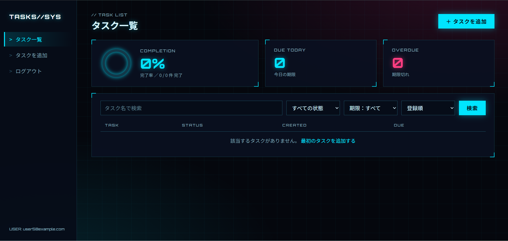
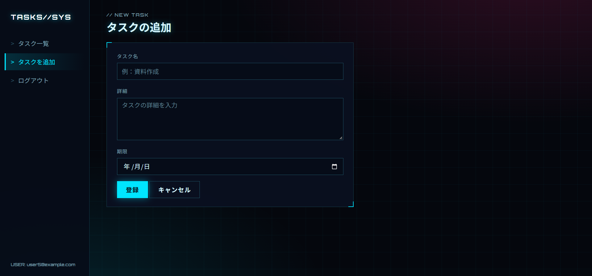
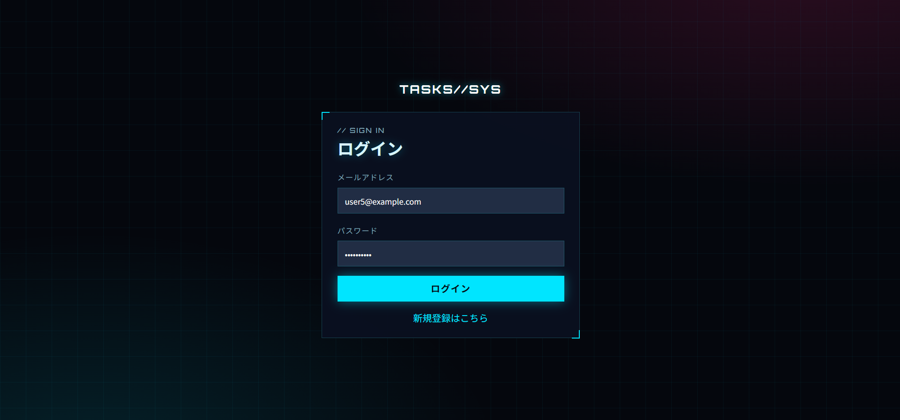

# タスク管理Webアプリケーション

## 概要

JavaとSpring Bootを使用して開発した、ユーザーごとにタスクを管理できるWebアプリケーションです。

ユーザー登録・ログインを行い、自分のタスクを登録、閲覧、編集、削除できます。

## 画面紹介

### タスク一覧画面

ログインしたユーザーのタスクを一覧で確認できます。完了率、今日が期限のタスク数、期限切れのタスク数を表示し、タスク名・状態・期限による絞り込みや並び替えができます。

### タスク追加画面

タスク名、詳細、期限を入力して、新しいタスクを登録できます。

### ログイン画面

登録したメールアドレスとパスワードでログインできます。パスワードはBCryptでハッシュ化して保存します。

## 使用技術

- Java 17
- Spring Boot
- Spring Data JPA
- Thymeleaf
- HTML / CSS
- Bootstrap
- Oracle Database
- Maven

## 主な機能

- ユーザーの新規登録
- ログイン・ログアウト
- タスクの追加・編集・削除
- タスクの完了状態の切り替え
- タスクの検索
- タスクの期限管理
- ユーザーごとのタスク管理

## セキュリティ対策

- BCryptによるパスワードのハッシュ化
- ログイン時のセッションID変更
- CSRFトークンによる不正なPOST送信の検証
- ユーザーIDによるタスクのアクセス制御
- データベース接続情報の環境変数管理
- サーバー側での入力チェック

## 実行環境

- Java 17
- Oracle Database
- Maven

データベースの初期構築には `project_sql.txt` を使用します。

データベースへの接続情報は、以下の環境変数で設定します。

- `DB_URL`
- `DB_USERNAME`
- `DB_PASSWORD`

## 今後の改善予定

- 認証・セッション管理のさらなる強化
- 自動テストの追加
- 画面の使いやすさの改善